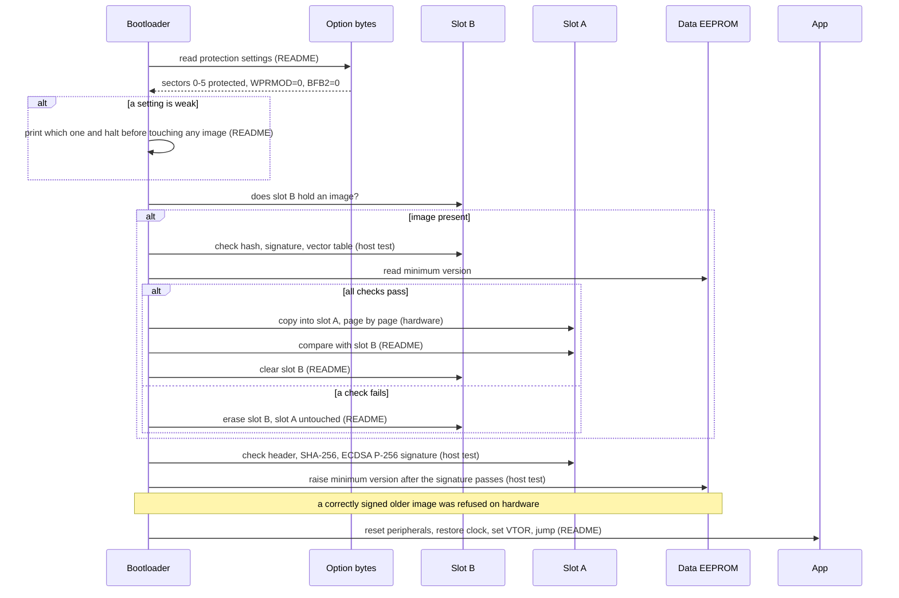
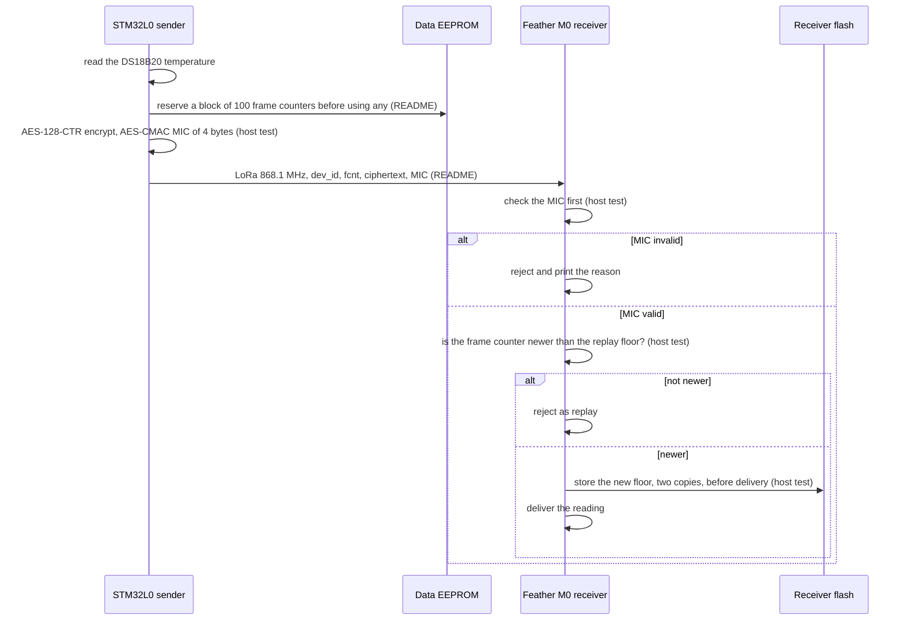

# Sequence diagrams: boot and secure link

Two diagrams, drawn from the README and `docs/API.md`. They are separate on purpose: a new image reaches slot B by debugger flash, not over LoRa (the in-field update path over UART or LoRa is on the not-done list in the README). Each message carries a tag: **hardware** (the README says it ran on the board), **host test** (checked by the PC tests) or **README** (stated there, and I have not separately checked it here).

## 1. Boot, every reset

## 2. Secure link, one reading

## Where the tags come from

| Tag | Evidence in the README |
|---|---|
| hardware, slot B copy | a signed update v1.3.0 to v1.3.1 still installed through slot B with the bootloader sectors write-protected |
| hardware, older image | a correctly signed older image was refused on hardware (stage 4) |
| host test, boot checks | SHA-256, ECDSA (RFC 6979 vectors), image checks with images made by the real signing tool, anti-rollback with simulated power cuts |
| host test, link | AES-128 against FIPS-197, AES-CMAC against the four RFC 4493 vectors, packet tamper and replay tests, counter-storage tests with simulated reboots and power cuts |

## Not drawn

- An in-field update over UART or LoRa into slot B. Not built.
- Swap-with-confirm updates. Not built, so a correctly signed but broken image cannot fall back.
- What happens when slot A fails its check. Not read for this diagram.
- The BFB2 bypass: with BFB2=1 the chip can boot bank 2 and skip the bootloader. The README describes it as a gap in the boot-time check.
- The receiver replay floor is stored in steps of 100, so after a receiver reboot up to 100 genuine packets may be rejected.
